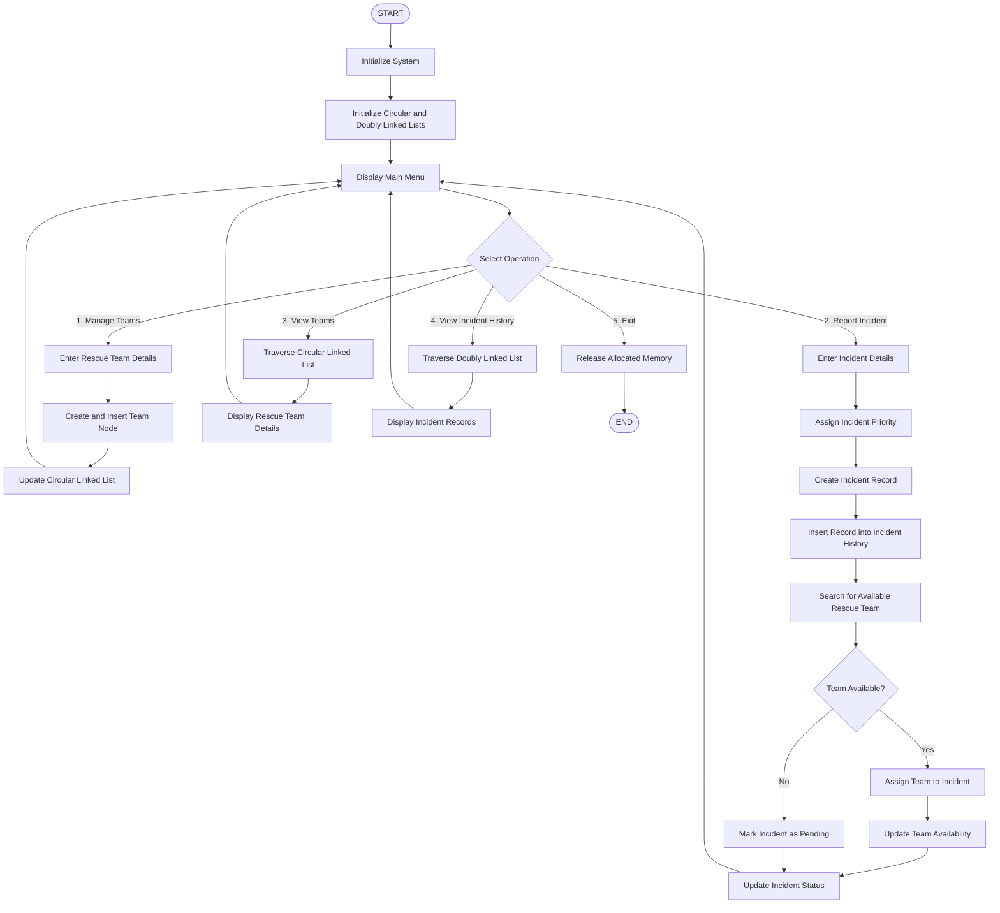

# RescueLoop — System Flowchart

## Complete System Workflow

## Flowchart Explanation

1. Initialization: Prepare the linked lists and initialize the system.
2. Team Management: Register rescue teams and maintain them in a circular linked list.
3. Incident Reporting: Accept incident details, assign priority, and save the incident record.
4. Team Allocation: Search for an available team. Assign it if available; otherwise, mark the incident as pending.
5. Team Display: Traverse the circular linked list to show registered teams.
6. Incident History: Traverse the doubly linked list to display stored incident records.
7. Exit: Release dynamically allocated memory and terminate the program.

Data structures: Circular Linked List and Doubly Linked List.
