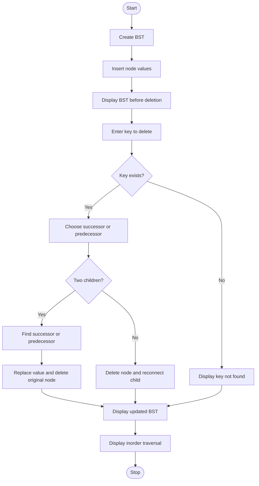

# BST Deletion of a Node with Two Children

## Aim
To write a C++ program to delete a node having two children from a Binary Search Tree using its inorder successor or inorder predecessor and display the updated tree.

## Objectives
- To understand BST deletion.
- To implement deletion using the inorder successor.
- To implement deletion using the inorder predecessor.
- To display the BST before and after deletion.
- To handle root deletion and keys that are not present in the BST.

## Theory
A Binary Search Tree (BST) is a binary tree in which values smaller than a node are stored in its left subtree, while larger values are stored in its right subtree.

When deleting a node with two children, two approaches are possible:

1. **Inorder Successor:** Find the smallest node in the right subtree and replace the target node with its value.
2. **Inorder Predecessor:** Find the largest node in the left subtree and replace the target node with its value.

After replacement, the original successor or predecessor node is deleted. This maintains the BST property.

## Original Problem
Write a C++ program to delete a node having two children from a BST using its inorder successor and display the updated tree.

## Implemented Modifications

### Modification 1: Successor and Predecessor
The program provides two deletion methods:
- Method 1 uses the inorder successor.
- Method 2 uses the inorder predecessor.

### Modification 2: Display Before and After Deletion
The program displays the BST structure before deletion and again after deletion. It also displays the inorder traversal.

### Modification 3: Root and Absent-Key Handling
- The root can be deleted, including when it has two children.
- If the requested key is absent, an appropriate message is displayed.
- Invalid deletion-method choices leave the tree unchanged.

## Algorithm
1. Start.
2. Create an empty BST.
3. Enter the number of nodes and their values.
4. Insert the values into the BST.
5. Display the original tree.
6. Enter the key to delete.
7. Search for the key.
8. If the key is absent, display a message.
9. If the key exists, select the successor or predecessor method.
10. If the node has two children:
    - Find the selected successor or predecessor.
    - Replace the node's value.
    - Delete the original successor or predecessor.
11. If the node has zero or one child, delete it and reconnect the remaining child, if any.
12. Display the updated tree and inorder traversal.
13. Stop.

## Flowchart



## Test Cases

### Test Case 1: Delete Root Using Successor

**Input**
```text
Enter number of nodes: 7
Enter node values: 50 30 70 20 40 60 80
Enter node to delete: 50
Enter choice: 1
```

**Expected inorder traversal**
```text
20 30 40 60 70 80
```

**Expected result:** The root value 50 is replaced with its inorder successor, 60.

### Test Case 2: Delete Root Using Predecessor

**Input**
```text
Enter number of nodes: 7
Enter node values: 50 30 70 20 40 60 80
Enter node to delete: 50
Enter choice: 2
```

**Expected inorder traversal**
```text
20 30 40 60 70 80
```

**Expected result:** The root value 50 is replaced with its inorder predecessor, 40.

### Test Case 3: Key Not Found

**Input**
```text
Enter number of nodes: 5
Enter node values: 50 30 70 20 40
Enter node to delete: 100
```

**Expected message**
```text
Node 100 not found in the BST.
```

The BST remains unchanged.

### Test Case 4: Delete a Leaf Node

**Input**
```text
Enter number of nodes: 5
Enter node values: 50 30 70 20 40
Enter node to delete: 20
Enter choice: 1
```

**Expected inorder traversal**
```text
30 40 50 70
```

### Test Case 5: Delete a Node with One Child

**Input**
```text
Enter number of nodes: 4
Enter node values: 50 30 70 20
Enter node to delete: 30
Enter choice: 1
```

**Expected inorder traversal**
```text
20 50 70
```

## Time Complexity
Let `n` be the number of nodes and `h` be the height of the BST.

- Insertion: O(h) per node.
- Searching: O(h).
- Deletion: O(h).
- Displaying the tree: O(n).
- Inorder traversal: O(n).

In a balanced BST, searching and deletion take O(log n) time. In the worst case, they take O(n) time.

## Applications
- Maintaining sorted data.
- Searching and updating records.
- Implementing dictionaries and sets.
- Understanding binary tree operations.

## Conclusion
The program implements BST deletion using both the inorder successor and predecessor. It displays the tree before and after deletion and handles root deletion and absent keys while maintaining the BST property.


## Test cases to demonstrate your modifications

Use these four tests for your project demonstration.

| Test | What it demonstrates | Expected result |
|---|---|---|
| 1 | Delete root using successor | Root becomes `60` |
| 2 | Delete root using predecessor | Root becomes `40` |
| 3 | Delete an absent key (`100`) | Not-found message; tree unchanged |
| 4 | Display before and after deletion | Updated tree structure and sorted inorder output |
```
